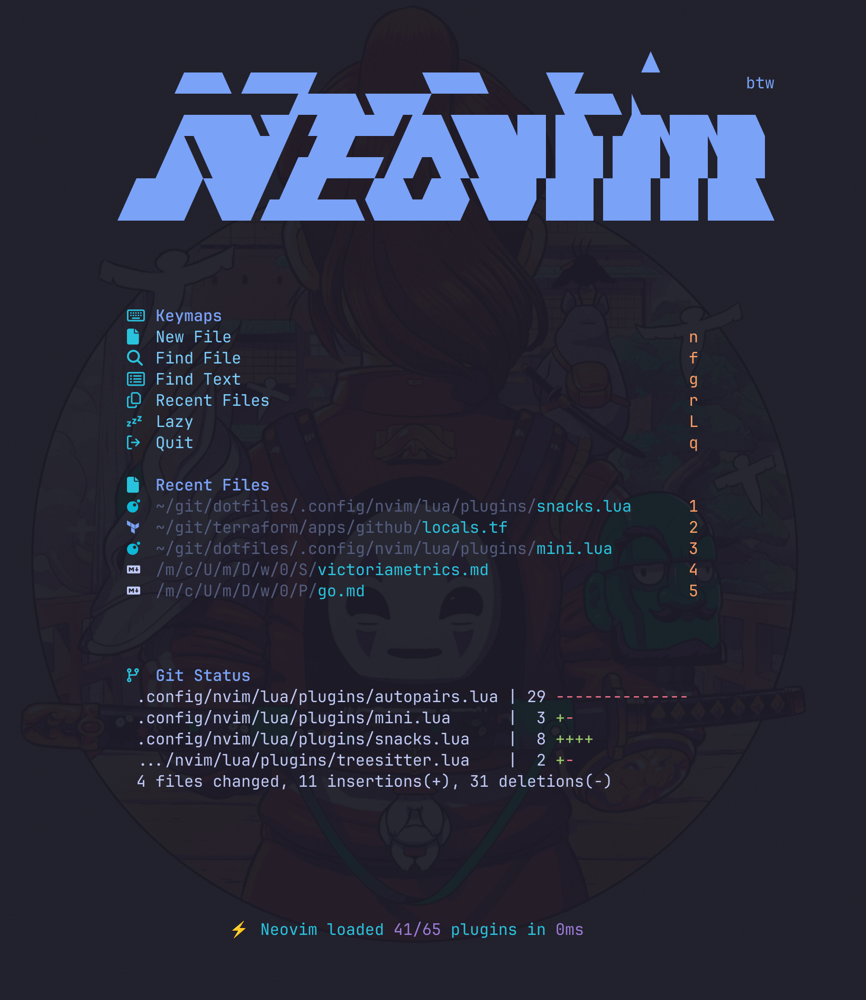

# Dotfiles



Personal development environment configuration, primarily for macOS. `Brewfile` lists packages; `.config/` contains application configs; `ai/` deploys agent config separately.

## Current setup

- **Terminal:** Ghostty (TokyoNight Day/Night follows system appearance), JetBrainsMono Nerd Font.
- **Shell:** zsh + Oh My Zsh, Starship, Atuin, zoxide, fzf, direnv (via Vorpal on personal machines).
- **Workspace:** Herdr with auto-switching TokyoNight Day/Night themes, workspace/session helpers and Ctrl-Space keybindings. tmux config and scripts remain available as an alternative; its custom theme is disabled.
- **Editor:** Neovim + lazy.nvim, LSP, Treesitter, DAP, completion and Git tooling. TokyoNight follows system light/dark preference.
- **Kubernetes:** k9s uses `terminal` skin (terminal background/foreground); custom dark skins remain in `.config/k9s/skins/`.
- **CLI:** lazygit uses default terminal colors; bat selects light/dark syntax theme automatically; Starship uses terminal foreground for Kubernetes, Helm and Lua prompt segments.
- **Window management:** Aerospace on macOS. GlazeWM and Hyprland configs remain for other environments.
- **AI:** pi, Claude Code, Codex and opencode share `ai/shared/AGENTS.md` and reusable skills; harness-specific settings live under `ai/` or `.config/opencode/`.

### AI Agents (`ai/`)
Layout is `ai/shared/` (vendor-neutral) + one dir per harness. `ai/bootstrap.sh`
links shared config to harness paths without replacing existing regular files.

| Source | Deployed to | Consumed by |
|---|---|---|
| `ai/shared/AGENTS.md` | `~/.agents/AGENTS.md`, `~/.claude/AGENTS.md`, `~/.codex/AGENTS.md`, `~/.pi/agent/AGENTS.md`, `~/.config/opencode/AGENTS.md` | shared context (Claude Code via `CLAUDE.md` import) |
| `ai/shared/skills/<name>` | `~/.claude/skills/<name>`, `~/.codex/skills/<name>`, `~/.agents/skills/<name>` (per-skill) | Claude Code, Codex, pi (`~/.agents` is pi's native path) |
| `ai/pi/models.json` | `~/.pi/agent/models.json` | pi — custom model provider endpoints |
| `ai/pi/settings.json` | `~/.pi/agent/settings.json` | pi — theme, TUI, packages, warnings |
| `ai/pi/mcp-adapter.json` | `~/.pi/agent/mcp-adapter.json` | pi-mcp-adapter — MCP server endpoints (gateway) |
| `ai/claude/CLAUDE.md` | `~/.claude/CLAUDE.md` | Claude Code only — imports `AGENTS.md`, adds herdr/CC rules |
| `ai/claude/agents/<name>` | `~/.claude/agents/` | Claude Code subagents (`kate`, `mike`, `gomez`, `pandey`, `rachel`) |
| `ai/claude/settings.json` | `~/.claude/settings.json` | Claude Code |
| `ai/claude/*status_line.sh` | referenced by `settings.json` | Claude Code |

Claude Code personas live in `ai/claude/agents/`; pi uses `pi-subagents` as a package, not those Claude persona files. Third-party skills (e.g. `herdr`, `humanizer`) remain installer-managed in `~/.agents/skills/`. Bootstrap links repo-owned skills per skill rather than replacing installed ones. See [ai/README.md](ai/README.md) for full symlink map.

## Other configs and scripts

- `.config/opencode/`: opencode agent config; `.config/tmux/`: optional tmux keybindings/plugins (custom theme source commented out).
- `.config/nvim/`: Lua Neovim config with LSP, DAP, Treesitter, completion, Git and Obsidian integrations.
- `.aws/config`, `.ssh/config`: cloud and SSH client settings.
- `scripts/herdr-*`, `scripts/tmux-*`: workspace/session helpers; `scripts/jws-*`: JWS helpers.
- `Brewfile`: Homebrew CLI tools and macOS apps, including tools without repo-managed config.

## Bootstrap

Everything is wired through a `Taskfile.yml`. Only GNU Stow is a hard
requirement; the Homebrew step is skipped automatically on machines without it.

```sh
task            # list available tasks
task doctor     # report which dependencies are present
task bootstrap  # packages + stow + AI config
```

| Task | What it does |
|---|---|
| `doctor` | Reports which of `stow`, `git`, `nvim`, `brew`, `luacheck` are installed |
| `packages` | `brew bundle --file Brewfile`; prints a note and skips when brew is absent |
| `stow:dry` | Previews the symlinks stow would create in `$HOME` |
| `stow` | Links this repo into `$HOME` |
| `unstow` | Removes those symlinks |
| `ai` | Runs `ai/bootstrap.sh` (`ai/` is excluded from stow, so it links separately) |
| `bootstrap` | `packages` → `stow` → `ai` |
| `check` | Loads the nvim config headless and lints Lua when `luacheck` is present |

Install `go-task` itself first (`brew install go-task`, or see
[taskfile.dev](https://taskfile.dev/installation/) on non-brew machines).

### On machines without Homebrew

`task packages` is a no-op there. The `Brewfile` stays the canonical package
list — install the equivalents with the local package manager, then run:

```sh
task stow
task ai
```

### Manual equivalents

If you would rather not install `go-task`:

```sh
brew bundle --file Brewfile          # macOS only
stow -n -v -d ~/git -t "$HOME" dotfiles   # dry run
stow -v -d ~/git -t "$HOME" dotfiles      # apply
./ai/bootstrap.sh
```

## How the stow layout works

The `.stow-local-ignore` file keeps repo metadata, docs, archives, the
`Taskfile.yml`, and non-home-shaped AI config out of the link set.

Stow links repo files into `$HOME` where no conflicting files exist. Existing real files are not replaced by `task stow`; check `task stow:dry` and reconcile conflicts before assuming runtime config matches repo. Agent files use `ai/bootstrap.sh` instead; it updates existing symlinks but leaves real files untouched.

Zsh uses `~/.zshenv` to set `ZDOTDIR=$HOME/.config/zsh`, then loads `~/.config/zsh/.zshrc`. Shell config adds `$HOME/.local/bin` and `$HOME/scripts` to `PATH`; `scripts/bootstrap.sh` links executable helpers into `~/.local/bin`.
